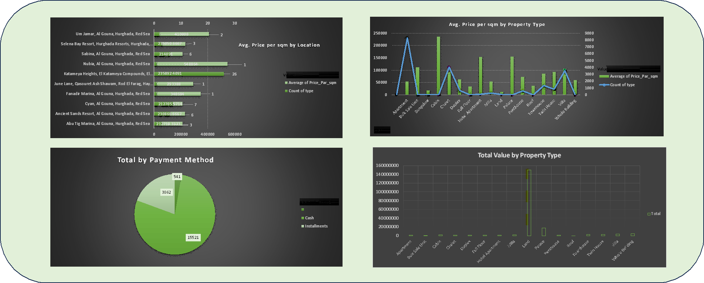

# 🏠 Real Estate Analytics Dashboard – Hurghada & Red Sea

An Excel-based data analysis project focused on real estate listings in *Hurghada* and the *Red Sea* region of Egypt.

## 📊 Project Overview
This dashboard analyzes real estate data to provide insights into pricing, property types, locations, and payment methods in the Hurghada market.

## 🛠️ Tools Used
- Microsoft Excel
- Pivot Tables
- Pivot Charts
- Data Visualization

## 🔍 Key Analyses
- Average price per square meter by *Location*
- Average price per square meter by *Property Type*
- Property distribution by *Payment Method* (Cash vs Installments)
- Total property value by *Property Type*

## ✨ Project Highlights
- Analyzes real estate listings across different locations and property categories
- Compares pricing metrics and property values
- Explores payment method preferences (Cash & Installments)
- Focused on the Hurghada – Red Sea real estate market

## 📌 Project Details
| Item              | Details                          |
|-------------------|----------------------------------|
| *Domain*        | Real Estate Analytics            |
| *Location*      | Hurghada – Red Sea, Egypt        |
| *Tools*         | Microsoft Excel                  |
| *Status*        | Completed           

Dashboard preview
